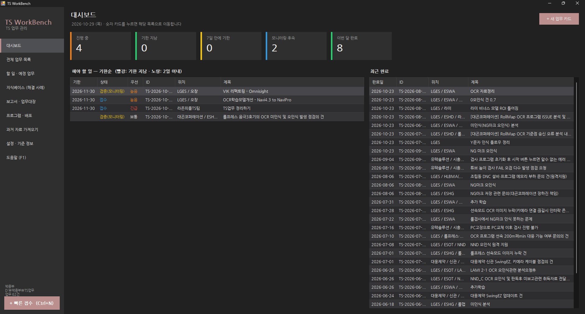
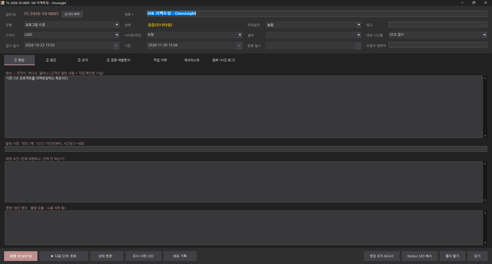

# TS WorkBench

TS(Technical Support) 업무를 **업무 카드 한 가지 형식**으로 기록하고, 입력한 내용으로 현장 조치 보고서·주간/월간 보고·엑셀 업무대장·Notion용 Markdown을 자동으로 만드는 WinForms 도구입니다.

- 현장 출동, 원격·사무실 분석, 프로그램 수정, HW 조치, 정기 점검, 문의 응대를 모두 같은 구조로 관리
- OCR 같은 시스템 구분은 탭이 아니라 카드의 **대상 시스템** 칸 → 어떤 설비·회사에도 그대로 사용
- 데이터는 폴더 하나(JSON)에 저장 → 폴더를 복사하면 다른 PC·다른 회사로 그대로 이전
- 화면은 OmniSight와 같은 다크 테마, 글꼴은 실행 파일에 넣은 나눔고딕 (OmniSight FontManager 방식)
- 프로그램 · 배포: 버튼 ① 등록 ② 새 버전 배포 ③ 설치 기록. Git 명령은 도구가 대신 실행 (VS2022에서 커밋만), 사이트별 설치 버전·NAS 코드 백업
- 매일 자동 백업, 유사 사례 찾기, 반복 업무 복제
- 프로그램 안 **도움말**(F1 = 지금 화면 설명, 목차·검색) — `docs\`의 문서를 그대로 보여 줌



## 왜 만들었나

설비 비전 검사 현장의 TS 업무(문의·원격 분석·현장 출동·프로그램 수정·배포·보고)는 메일·엑셀·폴더에 흩어지기 쉽습니다. 그러면 같은 증상이 다시 와도 예전 해결 방법을 못 찾고, 어느 설비에 몇 버전이 깔렸는지도 기억에 의존하게 됩니다. TS WorkBench는 **입력은 업무 카드 한 번, 보고서·배포 기록·백업은 자동**을 목표로 만들었습니다. 자세한 의도와 구조는 [docs/개발_가이드.md](docs/개발_가이드.md)에 있습니다.

| | |
| --- | --- |
|  |  |
| 업무 카드 (현상 → 원인 → 조치 → 검증) | 새 버전 배포 (이름표·배포본·설치 기록·NAS 백업을 한 번에) |

## 문서

| 문서 | 내용 |
| --- | --- |
| [docs/사용설명서.md](docs/사용설명서.md) | 설치, 화면별 사용법(프로그램 · 배포, 자동 백업 포함), 단축키, 백업·이전, 템플릿 수정 |
| [docs/백업_이전_가이드.md](docs/백업_이전_가이드.md) | 다른 PC에서 똑같이 쓰려면 어디를 복사하는지, 평소 백업, 고장 났을 때 복구 |
| [docs/TS업무관리_가이드.md](docs/TS업무관리_가이드.md) | TS 업무를 어떻게 관리하는지: 원칙, 상태 흐름, 기록 요령, 하루·주간 루틴, 예제 3건 |
| [docs/배포관리_가이드.md](docs/배포관리_가이드.md) | 터미널 없이 버전 관리: 프로그램 등록, 새 버전 배포, 커밋 메시지 규칙, 과거 zip 가져오기, 3년 치 자료 정리 순서 |
| [docs/개발_가이드.md](docs/개발_가이드.md) | 만든 이유(작업 의도), 설계 원칙, 코드 구조, 업무 저장·새 버전 배포 흐름, 데이터 파일, 빌드·검증, 화면 모음 |
| [docs/examples/TSWorkData](docs/examples/TSWorkData) | 예제 데이터 폴더 (업무 6건, 배포본 2건 + 생성된 보고서 샘플) |

## 빌드

- Visual Studio 2022, .NET Framework 4.7.2, C# 7.3
- `src\TSWorkBench.sln`을 열고 빌드 (NuGet: Newtonsoft.Json, ClosedXML 자동 복원)
- 명령줄: `MSBuild src\TSWorkBench.sln /restore /p:Configuration=Release`

## 구조

```
src\TSWorkBench\
  Models\     업무 카드(WorkItem), 프로그램(ProgramInfo), 배포 기록(ReleaseRecord), 기준 정보(MasterData), 설정
  Storage\    JSON 저장(원자적 저장 + .bak), 작업 공간(Workspace), 배포 기록, 자동 백업, 오류 로그
  Services\   상태 흐름(WorkflowRules), 통계, 보고서·엑셀, 과거 자료 가져오기, 유사 사례, 배포 패키지,
              Git 실행(GitRunner), 버전 번호(VersionUtil), 프로그램 등록·배포·과거 버전(ProgramService)
  Theme\      다크 테마 색·컨트롤 (DarkButton, NavButton, DarkGrid, DarkComboBox, DateBox, StatTile), FontManager
  Forms\      메인 창, 업무 카드, 빠른 접수, 유사 사례, 프로그램 등록, 새 버전 배포, 과거 버전 가져오기,
              설치 기록, 폴더 선택(NAS 경로 입력 가능)
  Pages\      대시보드, 업무 목록, 지식베이스, 보고서, 프로그램 · 배포, 가져오기, 설정, 도움말
  (빌드하면 docs\*.md·docs\images가 실행 파일 옆 Help\로 복사되어 도움말 화면에 나옵니다.
   기능을 바꾸면 docs\의 문서도 같이 고칩니다.)
  Templates\  보고서 기본 템플릿 (첫 실행 때 데이터 폴더로 복사)
  Resources\  NanumGothic.ttf (실행 파일에 포함)
src\TSWorkBench.Checks\   화면 없이 핵심 로직을 확인하는 검증 프로그램
```

검증: `src\TSWorkBench.Checks\bin\Debug\TSWorkBench.Checks.exe` → `ALL PASSED`

## 라이선스 참고

- 나눔고딕(NanumGothic.ttf)은 네이버의 SIL Open Font License 1.1 글꼴로, 프로그램에 포함해 배포할 수 있습니다 (글꼴 자체를 단독 판매하는 것은 불가).
