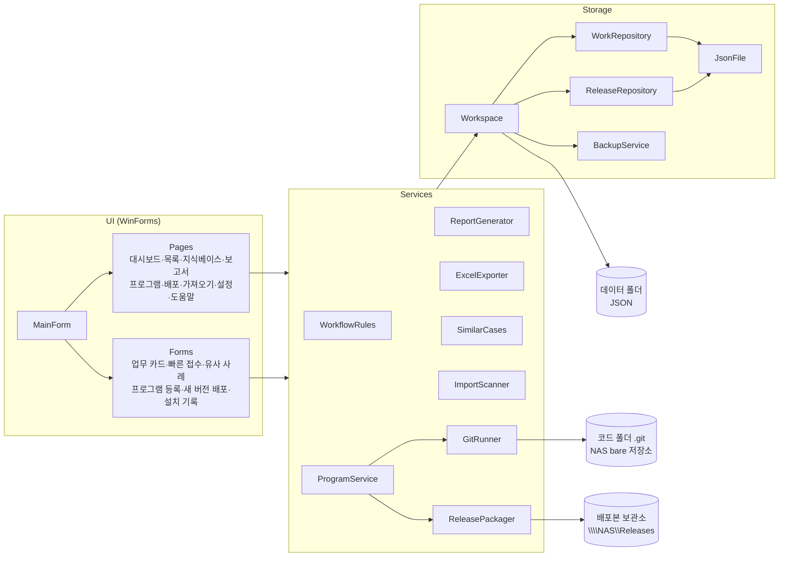
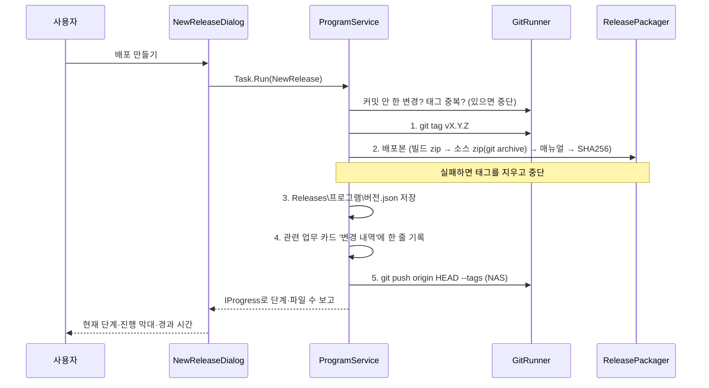
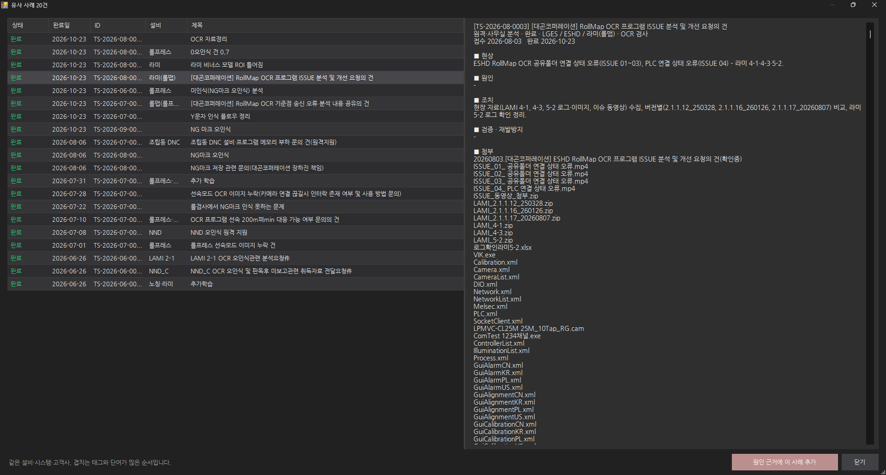
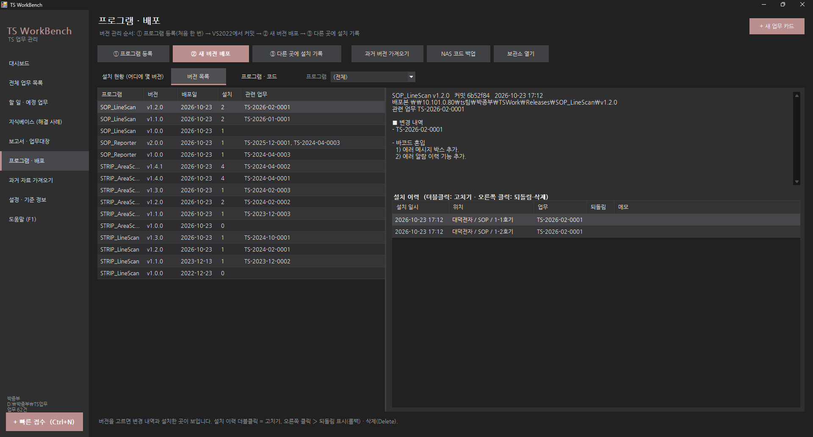

# TS WorkBench 개발 가이드

> 코드 구조 · 작업 의도 · 설계 결정. 기능을 고치거나 이어서 개발할 사람을 위한 문서입니다.
> 사용법은 [사용설명서.md](사용설명서.md)를 보세요.

---

## 1. 왜 만들었나 (작업 의도)

설비 비전 검사(OCR·외관 검사) 현장의 TS(Technical Support) 담당자는 하루에도 여러 종류의 일을 합니다.

- 전화·메일로 들어오는 문의, 원격 분석, 현장 출동, HW 교체, 검사 프로그램 수정, 정기 점검
- 고친 프로그램을 여러 사이트·설비에 배포하고, 어디에 어느 버전이 깔렸는지 기억하기
- 주간·월간 보고, 고객 제출용 현장 조치 보고서

이 기록이 메일·엑셀·폴더·메모에 흩어져 있으면 다음 문제가 생깁니다.

| 문제 | TS WorkBench의 답 |
| --- | --- |
| 같은 증상이 다시 와도 예전에 어떻게 고쳤는지 못 찾음 | 모든 업무를 **같은 구조의 업무 카드**(현상 → 원인 → 조치 → 검증)로 남기고, 지식베이스·유사 사례로 찾음 |
| 업무 종류마다 양식이 달라 보고서 만들 때 다시 정리 | 카드 한 가지 형식에서 **보고서·엑셀·Notion MD를 자동 생성** |
| 어느 설비에 몇 버전이 깔렸는지, 그 버전의 소스가 무엇인지 모름 | **버튼 3개(등록·새 버전 배포·설치 기록)**로 Git 이름표·배포본·설치 이력을 남김. Git 명령은 도구가 대신 실행 |
| 날짜별 zip으로만 보관해 온 3년 치 소스 | **과거 버전 가져오기**로 날짜 순서대로 Git 기록으로 변환 |
| PC 고장·이전 시 기록 유실 | 데이터는 **폴더 하나(JSON)**. 매일 자동 백업, 코드는 NAS로 push |

원칙: **"입력은 한 번, 결과물은 자동으로."** 사용자는 VS2022에서 커밋만 하고, 나머지(태그·패키지·백업·기록)는 도구가 합니다.

---

## 2. 설계 원칙

1. **업무 형식은 하나** — 시스템(OCR 등)별로 탭을 나누지 않고 카드의 `대상 시스템` 칸으로 구분. 그래서 어느 회사·설비에도 그대로 씁니다.
2. **데이터는 사람이 읽을 수 있는 파일** — DB 없이 JSON. 폴더를 복사하면 이전이 끝납니다. 저장은 임시 파일 → 바꿔치기(+ `.bak`)로 원자적으로 합니다.
3. **지우지 않는다** — 업무·프로그램 삭제는 `Trash\`로 이동. 배포본 폴더는 덮어쓰지 않고 거부합니다.
4. **사용자는 Git을 몰라도 된다** — `GitRunner`가 `git.exe`를 직접 실행. 사용자는 VS2022의 Git 변경 내용 창에서 커밋만.
5. **화면을 멈추지 않는다** — Git·zip·백업은 `Task.Run`으로 돌리고 `IProgress<T>`로 진행을 UI 스레드에 보냅니다.
6. **기존 환경 유지** — .NET Framework 4.7.2, C# 7.3, WinForms. 외부 패키지는 Newtonsoft.Json, ClosedXML 두 개뿐.

---

## 3. 전체 구조



### 폴더별 역할

| 폴더 | 내용 | 대표 클래스 |
| --- | --- | --- |
| `Models\` | 저장되는 데이터 | `WorkItem`(업무 카드), `ProgramInfo`, `ReleaseRecord`·`Deployment`, `MasterData`, `AppSettings`, 열거형·한글 이름(`Labels`) |
| `Storage\` | 파일 저장·읽기 | `Workspace`(데이터 폴더 1개 = 작업 공간), `WorkRepository`(업무 ID 부여·저장·휴지통), `ReleaseRepository`, `JsonFile`(원자적 저장), `BackupService`, `ErrorLog`, `LocationStore` |
| `Services\` | 화면과 무관한 로직 | `WorkflowRules`(상태 흐름·완료 조건·후속 업무), `StatsService`, `ReportGenerator`·`TemplateEngine`, `ExcelExporter`, `ImportScanner`, `SimilarCases`, `WorkQuery`, `ProgramService`·`GitRunner`·`ReleasePackager`·`VersionUtil`, `HelpDocument` |
| `Pages\` | 메인 창 오른쪽 화면 | `PageBase`를 상속. `HelpTopic`으로 F1 위치 지정 |
| `Forms\` | 별도 창 | `WorkItemForm`, `QuickAddForm`, `NewReleaseDialog`, `ProgramSetupDialog`, `ImportVersionsDialog`, `DeployDialog`, `FolderPicker` |
| `Theme\` | 다크 테마 | `DarkForm`(모든 창의 바탕, 최대화로 시작), `DarkTheme`(색 한 곳에서 정의), `DarkButton`·`DarkGrid`·`DarkComboBox`·`DateBox`·`NavButton`·`StatTile`, `FontManager`(내장 나눔고딕) |
| `Templates\` | 보고서 기본 양식 | 첫 실행 때 데이터 폴더로 복사 → 사용자가 고쳐 씀 |
| `TSWorkBench.Checks\` | 화면 없는 검증 프로그램 | 업무 ID·저장·상태 흐름·보고서·가져오기·Git 배포 흐름을 임시 폴더에서 실행해 확인 |

---

## 4. 주요 흐름

### 4.1 업무 카드 저장

1. `WorkItemForm`에서 저장 → `WorkRepository.Save(item)`
2. ID가 없으면 `앞머리-연도-월-번호`(예: `TS-2026-10-0005`)를 부여. 번호는 달마다 0001부터, 휴지통에 있는 번호도 다시 쓰지 않습니다.
3. `Items\연도\ID\item.json`에 `JsonFile.Write` — 임시 파일에 쓰고 `File.Replace`로 바꿔치기, 직전 파일은 `.bak`.
4. 상태를 바꾸면 `WorkflowRules`가 허용 여부와 완료 전 필수 항목을 검사하고, 완료 시 모니터링·재방문 후속 업무를 제안합니다.

### 4.2 새 버전 배포 (② 버튼)



- 진행 중에는 창을 닫을 수 없습니다 (`OnFormClosing`에서 막음). 작업은 취소할 수 없으므로, 닫고 다시 누르면 이름표가 이미 있다는 오류가 나던 문제를 막기 위함입니다.
- NAS 백업이 실패해도 배포는 성공으로 둡니다 (다음 실행 때 자동 백업이 다시 시도).
- `배포 안 한 커밋 N개` = 배포 기록의 최신 버전 태그 뒤에 생긴 커밋 수 (`GitRunner.CommitsSince`).

### 4.3 프로그램 시작 시

`MainForm`이 뜬 뒤 백그라운드에서: 오늘 자동 백업이 없으면 `BackupService`가 zip을 만들고, 등록된 프로그램 코드를 NAS로 push합니다. 실패는 `%AppData%\TSWorkBench\error.log`에만 남기고 화면은 기다리지 않습니다.

### 4.4 도움말

빌드할 때 `docs\*.md`와 `docs\images\*.png`가 실행 파일 옆 `Help\`로 복사되고, `HelpPage`가 Markdown을 HTML로 바꿔 보여 줍니다. 각 페이지의 `HelpTopic`(예: `"3.7"`)이 F1을 눌렀을 때 열 제목입니다. **기능을 바꾸면 `docs\`의 문서도 같이 고칩니다.**

---

## 5. 데이터 파일

| 파일 | 내용 |
| --- | --- |
| `settings.json` | 이름·부서·회사·업무 ID 앞머리·배포본 보관소·자동 백업 폴더 |
| `masters.json` | 고객사·사이트·설비·대상 시스템(별칭 포함), 유형별 체크리스트 |
| `programs.json` | 프로그램 이름·코드 폴더·빌드 폴더·매뉴얼 폴더·NAS 코드 백업 위치 |
| `Items\연도\ID\item.json` | 업무 카드 1건 (+ `files\` 첨부, 보고서 HTML) |
| `Releases\프로그램\버전.json` | 버전·태그·커밋·배포본 경로·변경 내역·업무 ID·설치 이력(`Deployments`) |

배포본 폴더 구조 (`보관소\프로그램\vX.Y.Z\`):

```
{Program}_vX.Y.Z.zip          빌드 결과 (pdb·vshost 제외)
{Program}_vX.Y.Z_source.zip   그 버전의 소스 (git archive)
manual\                       매뉴얼
RELEASE_NOTES.md              변경 내역
SHA256SUMS.txt                파일 무결성 확인용 해시
```

---

## 6. 빌드 · 검증

```
MSBuild src\TSWorkBench.sln /restore /p:RestorePackagesConfig=true /p:Configuration=Release
src\TSWorkBench.Checks\bin\Release\TSWorkBench.Checks.exe   → ALL PASSED
```

- 로직을 바꾸면 `TSWorkBench.Checks\Program.cs`에 `Check("설명", 조건)`을 추가합니다.
- UI 스레드: 백그라운드 작업 결과는 `IProgress<T>`(UI 스레드에서 생성) 또는 `await` 뒤에서만 컨트롤을 만집니다.
- 새 창은 `DarkForm`, 새 화면은 `PageBase`를 상속하면 테마·글꼴·최대화가 자동으로 적용됩니다.

---

## 7. 화면 한눈에 보기

| | |
| --- | --- |
|  대시보드 |  전체 업무 목록 |
|  업무 카드 |  작업 이력 |
|  지식베이스 |  유사 사례 |
|  보고서 · 업무대장 |  과거 자료 가져오기 |
|  설치 현황 |  버전 목록 |
|  프로그램 · 코드 |  새 버전 배포 |
|  프로그램 등록 |  과거 버전 가져오기 |
|  빠른 접수 |  설정 · 기준 정보 |

---

## 8. 개발 이력

| 날짜 | 내용 |
| --- | --- |
| 2026-10-22 | 첫 버전: 업무 카드·대시보드·보고서·가져오기, 사용설명서·가이드 |
| 2026-10-22 | 업무 ID를 `앞머리-연도-월-번호`로, 기한·완료 일시에 시각 입력 |
| 2026-10-22 | 나눔고딕 내장, 프로그램 · 배포(등록·새 버전·설치 기록), 업무 ID 다시 부여 |
| 2026-10-22 | 폴더 선택 창을 탐색기 방식으로, NAS 백업 dubious ownership 수정 |
| 2026-10-23 | 도움말 화면(F1), 백업·이전 가이드, 프로그램 삭제·설치 기록 고치기 |
| 2026-10-23 | 새 버전 배포 진행 표시·진행 중 닫기 막기, 모든 창 최대화로 시작 |
