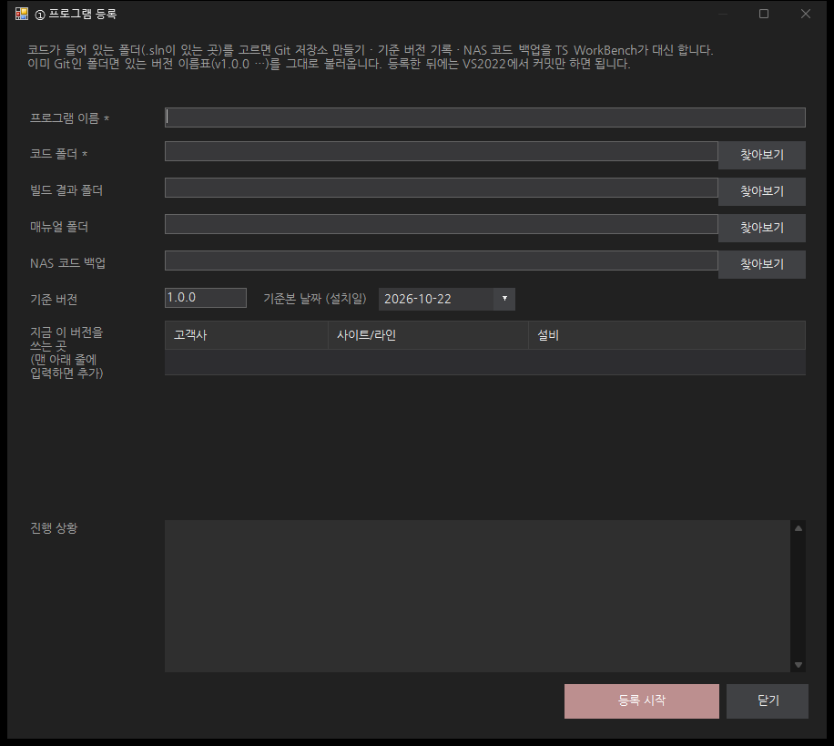
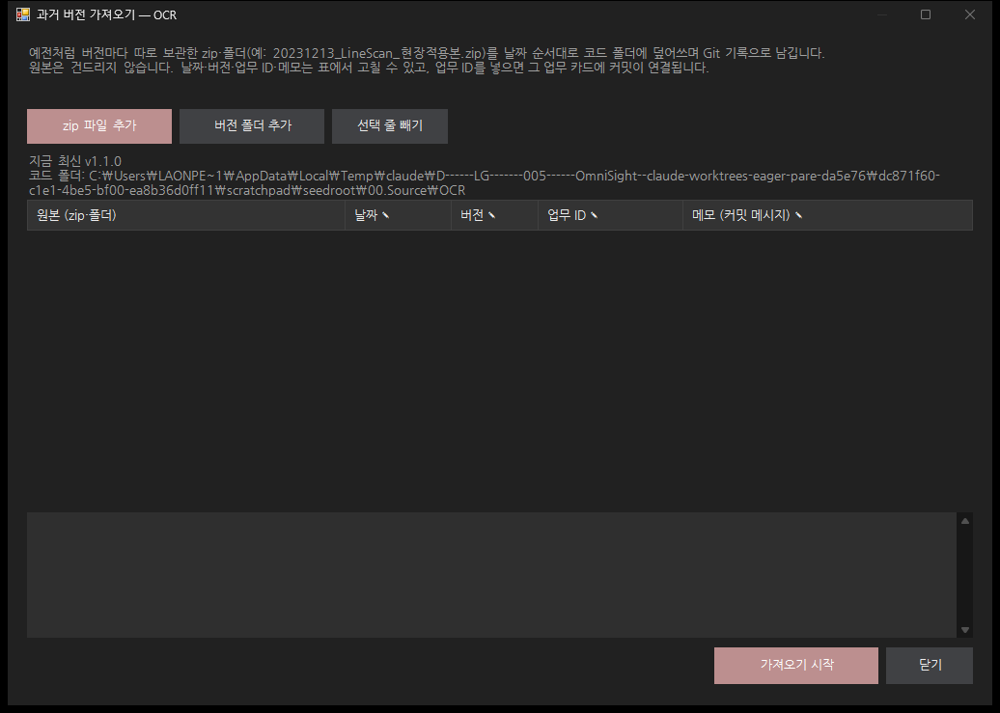
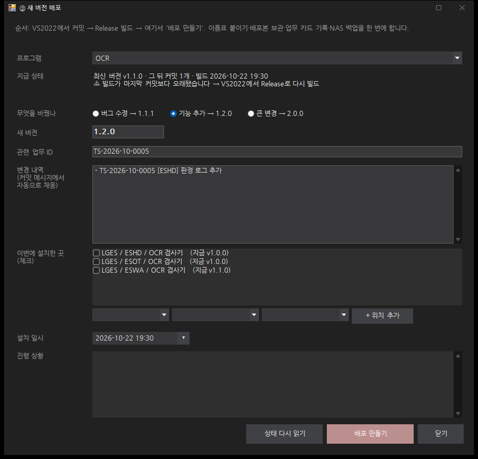
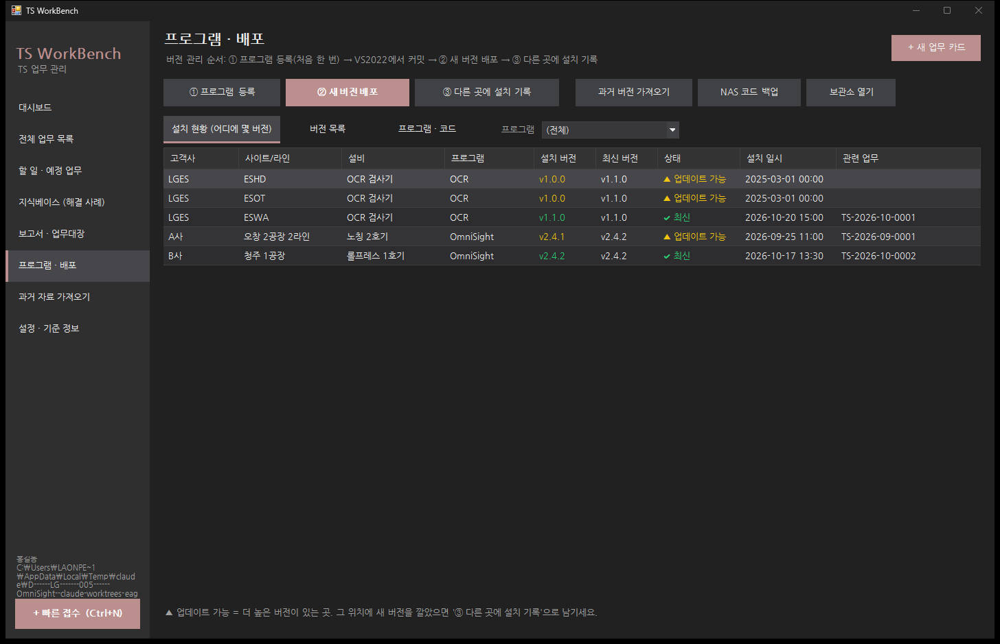
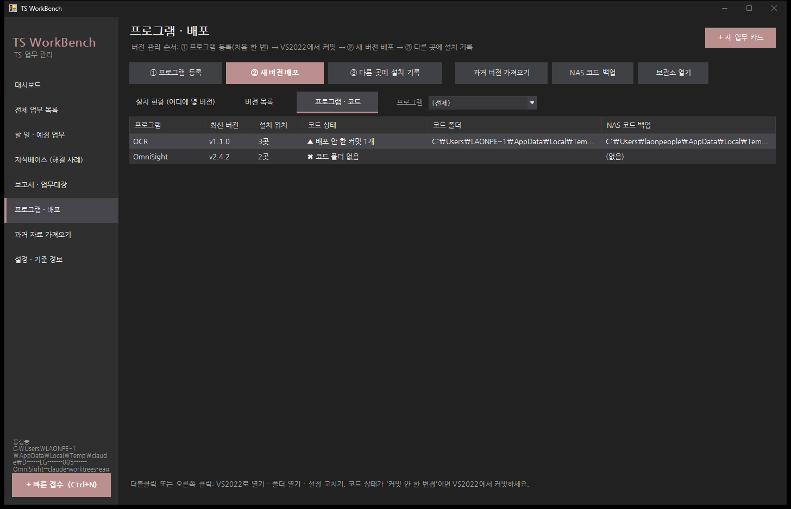

# 프로그램 버전 · 배포 관리 가이드 (쉬운 버전)

> **한 줄 요약**: 코드는 **VS2022에서 커밋만** 한다. 나머지(버전 이름표, 배포 파일 보관, 어느 사이트에 몇 버전이 깔렸는지, NAS 백업)는 **TS WorkBench 버튼**이 대신 한다. 터미널(검은 창) 명령은 쓰지 않는다.

---

## 0. 먼저 알아 둘 말 4개

| 말 | 뜻 | 비유 |
| --- | --- | --- |
| **커밋** | 코드를 고친 뒤 "여기까지 저장"하고 한 줄 설명을 남기는 것 | 일기 한 줄 쓰기 |
| **버전** | 사이트에 내보낸 프로그램의 번호 `1.0.0`, `1.1.0` … | 책의 판(1판, 2판) |
| **배포본** | 그 버전의 실행 파일 + 소스 + 매뉴얼을 묶어 NAS에 보관한 폴더. 한 번 만들면 고치지 않는다 | 도서관에 넣은 책 |
| **설치 기록** | "어느 사이트(설비)에 몇 버전을 언제 깔았다" | 대출 기록 |

---

## 1. 모든 자료가 있는 곳 (이것만 백업하면 끝)

```
내 PC
  D:\박종부\TS업무\                    ← 업무 카드·배포 기록 (TS WorkBench 데이터)
  D:\박종부\00.Source\<프로그램>\       ← 코드 작업 폴더 (VS2022로 여는 곳, 프로그램마다 1개)

NAS  \\10.101.0.80\ts팀\박종부\TSWork\   ← ★ 이 폴더 하나에 전부 모인다
  Backups\    TS WorkBench 업무 기록 (매일 자동 zip)
  Git\        모든 프로그램의 코드와 커밋 기록 (<프로그램>.git, 프로그램을 켤 때마다 자동 백업)
  Releases\   배포본 (<프로그램>\v1.1.0\ : 실행 파일 zip · 소스 zip · 매뉴얼 · 변경 내역)
```

- **TS WorkBench를 켤 때마다** 업무 기록 zip과 코드(커밋한 것)가 NAS로 자동 백업됩니다.
- PC가 고장 나도 NAS `TSWork` 폴더만 있으면 전부 되살릴 수 있습니다.
- 설정 › 배포본 보관소 / 자동 백업 폴더에 위 NAS 경로가 이미 들어 있습니다. 코드 백업(`Git`)은 보관소 옆에 자동으로 정해집니다.

---

## 2. 규칙 딱 3개

1. **프로그램 하나 = 코드 폴더 하나.** OCR이면 `D:\박종부\00.Source\OCR` 하나만. 사이트(ESWA·ESHD·ESOT)마다 폴더를 나누지 않습니다. 사이트는 **같은 코드의 다른 버전**을 쓰고 있을 뿐입니다.
2. **커밋 메시지 맨 앞에 업무 ID.** `TS-2026-10-0003 [ESWA] 검사 영역 이탈 수정` → 업무 카드와 코드가 자동으로 이어집니다.
3. **버전 번호는 앞으로만 올라간다.** 1.0.0 → 1.0.1(버그 수정) → 1.1.0(기능 추가) → 2.0.0(큰 변경). 내리거나 같은 번호로 다시 만들지 않습니다.

---

## 3. 처음 한 번: 프로그램 등록 (①)

**프로그램 · 배포 › ① 프로그램 등록**



| 칸 | 넣을 것 |
| --- | --- |
| 프로그램 이름 | `OCR` (짧게, 영어·숫자 권장) |
| 코드 폴더 | `.sln`이 있는 폴더. 이름을 쓰면 `D:\박종부\00.Source\OCR`이 자동으로 들어감 |
| 빌드 결과 폴더 | 자동으로 찾음 (`…\bin\Release`) |
| 매뉴얼 폴더 | `docs` 폴더가 있으면 자동 |
| NAS 코드 백업 | 자동 (`\\10.101.0.80\ts팀\박종부\TSWork\Git\OCR.git`) |
| 기준 버전 / 날짜 | `1.0.0` / 지금 현장 코드가 깔린 날 |
| 지금 이 버전을 쓰는 곳 | 고객사·사이트·설비를 한 줄씩. 예) LGES / ESWA / OCR 검사기, LGES / ESHD / …, LGES / ESOT / … |

**등록 시작**을 누르면 TS WorkBench가 알아서 합니다.
- 코드 폴더를 Git 저장소로 만들고 `bin`·`obj` 같은 빌드 찌꺼기는 빼기
- 지금 코드를 **기준본 v1.0.0**으로 기록
- 배포본 보관 (`Releases\OCR\v1.0.0\` 에 소스 zip·실행 파일 zip)
- 3사이트에 1.0.0 설치 기록
- NAS로 코드 백업

### 코드가 어떤 상태든 이렇게
| 지금 상태 | 할 일 |
| --- | --- |
| **코드 폴더 하나만 있다** | 위처럼 ① 등록만 하면 끝 |
| **날짜별 zip·폴더로만 있다** (예: `20221223_LineScan_현장적용본.zip`, `20231213_…zip`) | 코드 폴더 칸에 **아직 없는(빈) 폴더** `D:\박종부\00.Source\LineScan`을 적고 ① 등록 → **과거 버전 가져오기**(4장)에 zip을 **전부** 넣기. 가장 오래된 것이 기준본 1.0.0이 됩니다 |
| **이미 Git이다** (예: LineScan을 직접 커밋해 둔 폴더) | 그 폴더로 ① 등록. 있는 버전 이름표(v1.0.0…)를 그대로 불러오고, 이름표 없는 마지막 커밋에는 다음 버전 번호를 붙여 줍니다 |

---

## 4. 예전 버전 zip들을 한 번에 넣기 (과거 버전 가져오기)

**프로그램 · 배포 › 과거 버전 가져오기** (먼저 위쪽 "프로그램"에서 고르거나, 프로그램 보기에서 줄을 선택)



1. **zip 파일 추가** → 버전 zip들을 한꺼번에 선택 (폴더로 되어 있으면 **버전 폴더 추가**)
2. 날짜는 파일 이름(`20231213`)에서, 버전은 `1.1.0, 1.2.0…`으로 자동으로 채워집니다. 필요하면 표에서 고칩니다.
3. 그때 한 업무 카드가 있으면 **업무 ID** 칸에 `TS-2023-12-0002`처럼 넣습니다 → 그 카드 '변경 내역'에 커밋이 자동으로 적힘
4. **가져오기 시작** → 날짜 순서대로 "폴더 비우기 → zip 풀기 → 커밋 → 버전 이름표"를 반복합니다. (지워진 파일도 정확히 기록, zip 안에 폴더가 한 겹 더 있어도 알아서 벗김)

> VS2022로 그 코드 폴더를 열어 두었다면 **닫고** 하세요. 원본 zip은 건드리지 않습니다.

---

## 5. 평소: 코드를 고치고 배포하기 (②)

### 순서 (초등학생용)
1. **업무 카드**가 있는지 확인 (없으면 `Ctrl+N` 빠른 접수) → 업무 ID 확인 `TS-2026-10-0003`
2. **VS2022**로 코드 폴더의 `.sln` 열기 (프로그램 · 배포 › 프로그램 보기에서 줄을 **더블클릭**하면 바로 열림)
3. 코드 고치기 → **Git 변경 내용** 창(메뉴 보기 › Git 변경 내용)에서 커밋 (6장 규칙대로 메시지)
4. VS2022에서 **Release로 빌드**
5. TS WorkBench › **② 새 버전 배포**



| 칸 | 자동으로 되는 것 / 할 일 |
| --- | --- |
| 지금 상태 | ✔ 배포할 준비가 됐습니다 / ⚠ 커밋 안 한 변경 있음 / ⚠ 빌드가 오래됨 — ⚠가 있으면 VS2022에서 고치고 **상태 다시 읽기** |
| 무엇을 바꿨나 | 버그 수정 / 기능 추가 / 큰 변경 중 하나 → **새 버전 번호가 자동으로** 정해짐 |
| 관련 업무 ID | 커밋 메시지에서 **자동** |
| 변경 내역 | 지난 버전 뒤의 커밋 메시지로 **자동** (고쳐도 됨) |
| 이번에 설치한 곳 | 이번에 깐 곳만 **체크** (예: ESWA만). 처음 가는 곳은 아래 칸에 입력 후 **+ 위치 추가** |

**배포 만들기**를 누르면 한 번에:
- 커밋에 버전 이름표 `v1.1.0`
- `Releases\OCR\v1.1.0\` 에 실행 파일 zip + **소스 zip** + 매뉴얼 + 변경 내역 + SHA256
- ESWA 설치 기록
- 관련 업무 카드 '③ 조치 › 변경 내역'에 `배포: OCR v1.1.0 (커밋 abc1234) → ESWA …` 자동 기입
- NAS로 코드 백업

> 업무 카드 아래 **배포 기록 › 새 버전 배포**로 열면 그 카드의 ID와 위치가 미리 채워집니다.

---

## 6. 커밋 메시지 쓰는 법

**첫 줄 = `업무ID [사이트] 무엇을 했나`** (한 줄, 50자 안쪽)

```
TS-2026-10-0003 [ESWA] 검사 영역 이탈 수정
```

필요하면 한 줄 비우고 자세히:
```
TS-2026-10-0003 [ESWA] 검사 영역 이탈 수정

- 원인: ROI 계산 시 회전 보정 누락
- 수정: InspectionArea.cs 회전 각도 반영
- 설정: Recipe\ESWA.json  RoiMargin 10 → 14
```

| 좋은 예 | 나쁜 예 |
| --- | --- |
| `TS-2026-10-0003 [ESWA] 검사 영역 이탈 수정` | `수정` |
| `TS-2026-11-0002 [공통] 로그 보관 기간 설정 추가` | `1104 작업` |
| `TS-2026-11-0005 [ESHD] PLC 재연결 타임아웃 5초→10초` | `asdf`, `최종`, `진짜최종` |

- 업무 카드 없이 한 작은 정리는 ID 없이 `[공통] 주석 정리`처럼 써도 됩니다.
- 커밋은 **작게 자주**: "한 가지 고침 = 커밋 하나"가 나중에 찾기 쉽습니다.
- 사이트 이름 `[ESWA]`을 넣어 두면, 어느 사이트 요청으로 바꾼 것인지 기록에서 바로 보입니다.

---

## 7. 사이트별 버전 보기 · 나중에 다른 사이트에도 깔기 (③)

**프로그램 · 배포 › 설치 현황**



예) OCR — ESWA만 1.1.0, ESHD·ESOT는 1.0.0
| 사이트 | 설치 버전 | 최신 | 상태 |
| --- | --- | --- | --- |
| ESWA | v1.1.0 | v1.1.0 | ✔ 최신 |
| ESHD | v1.0.0 | v1.1.0 | ▲ 업데이트 가능 |
| ESOT | v1.0.0 | v1.1.0 | ▲ 업데이트 가능 |

나중에 ESHD에도 1.1.0을 깔았다면 → **③ 다른 곳에 설치 기록** → 배포본 `OCR v1.1.0`, 사이트 `ESHD`, 날짜 → 저장. (코드를 새로 고친 게 아니므로 새 버전을 만들지 않습니다.)

**설치 파일은 어디?** `\\10.101.0.80\ts팀\박종부\TSWork\Releases\OCR\v1.1.0\OCR_v1.1.0.zip` — 버전 목록에서 고르고 **보관소 열기**.

### 되돌렸을 때 (롤백)
1. 보관소의 이전 버전 zip(`v1.0.0`)으로 다시 설치
2. **버전 목록 › v1.1.0 › 설치 이력**에서 그 사이트 줄을 오른쪽 클릭 › **되돌림 표시** → 설치 현황이 다시 1.0.0으로

---

## 8. 3년 치 자료 한 번에 정리하는 순서

| 순서 | 무엇 | 어떻게 | 결과 |
| --- | --- | --- | --- |
| 1 | 업무 기록 | **과거 자료 가져오기** 메뉴로 보고서·메일 폴더 스캔 → 완료 업무로 등록 | 업무 카드 (언제 무엇을 했나) |
| 2 | 프로그램 목록 정하기 | 고객사별로 쓰는 프로그램을 적어 보기 (예: OCR, LineScan, …) | 프로그램 이름 |
| 3 | 프로그램마다 코드 정리 | `D:\박종부\00.Source\<프로그램>` 만들기 → 3장 표대로 **① 등록** → 날짜별 zip이 있으면 **과거 버전 가져오기** | 버전별 코드 기록 + 배포본 |
| 4 | 지금 사이트별 버전 | **③ 설치 기록**으로 각 사이트에 지금 깔린 버전 입력 | 설치 현황 표 |
| 5 | 업무 ↔ 코드 연결 | 중요한 건만: 가져오기 표의 **업무 ID** 칸 또는 업무 카드 '변경 내역' | 카드에서 코드, 코드에서 카드 |
| 6 | 백업 확인 | NAS `TSWork\Git`, `Releases`, `Backups`에 파일이 생겼는지 | 이 폴더 하나 = 전부 |

> 한 번에 다 하려 하지 말고 **프로그램 하나씩** 끝내세요. 하나 끝날 때마다 설치 현황에 그 프로그램이 보이면 성공입니다.

---

## 9. 자주 막히는 곳

| 화면에 이렇게 나와요 | 이렇게 하세요 |
| --- | --- |
| ⚠ 커밋 안 한 변경 n개 | VS2022 › Git 변경 내용 › 메시지 쓰고 **모두 커밋** → **상태 다시 읽기** |
| ⚠ 빌드가 마지막 커밋보다 오래됐습니다 | VS2022에서 **Release** 선택 후 빌드 → 상태 다시 읽기 |
| 마지막 버전 뒤에 새 커밋이 없습니다 | 고친 코드가 커밋됐는지 확인 |
| 새 버전은 지금 최신보다 높아야 합니다 | 버전 번호를 더 크게 (1.1.0 → 1.1.1) |
| NAS 백업 실패 | 배포는 이미 끝났습니다. NAS 연결 후 **NAS 코드 백업** 버튼 또는 다음 실행 때 자동 재시도 |
| git을 찾을 수 없습니다 | Git for Windows 설치 (VS2022 설치 관리자 › 개별 구성 요소 › Git for Windows) |
| 사이트마다 코드가 정말 달라요 | 먼저 **설정 파일**(Recipe·Config)로 나눌 수 있는지 보세요. 완전히 다른 프로그램이면 이름을 다르게 따로 등록 (`OCR_ESOT`) |

---

## 10. 프로그램 보기



- **코드 상태**: ✔ 깨끗함 / ● 커밋 안 한 변경 / ▲ 배포 안 한 커밋(커밋은 했는데 아직 ② 안 함)
- 줄 **더블클릭** = VS2022로 열기. 오른쪽 클릭: 코드 폴더·빌드 폴더 열기, 과거 버전 가져오기, 설정 고치기(폴더·NAS 위치 변경)
