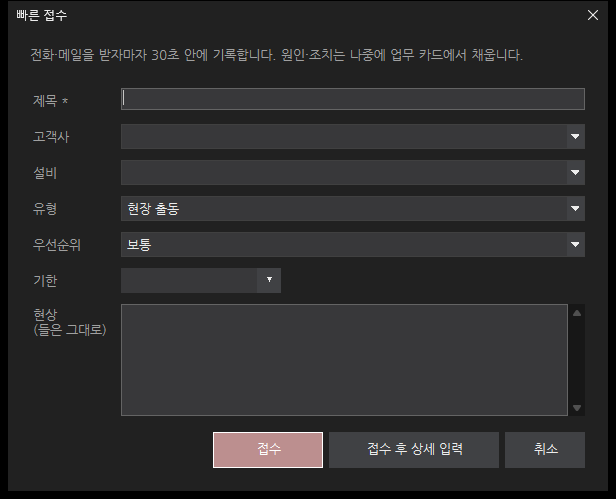
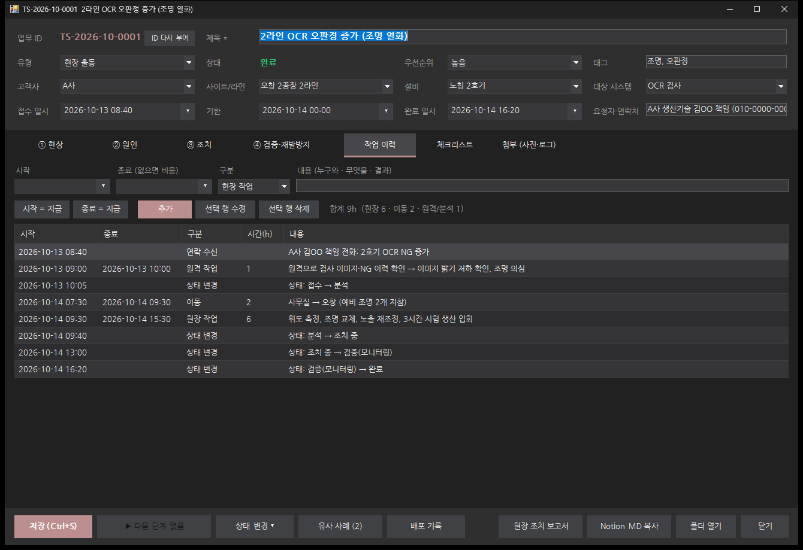
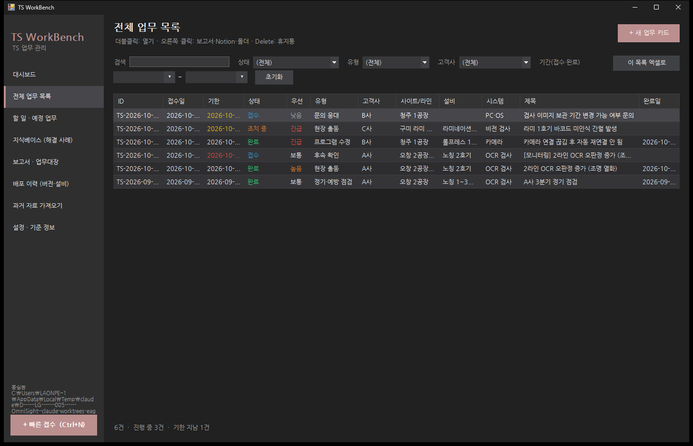
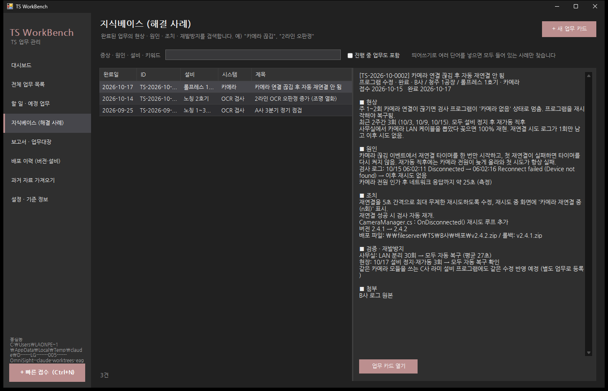
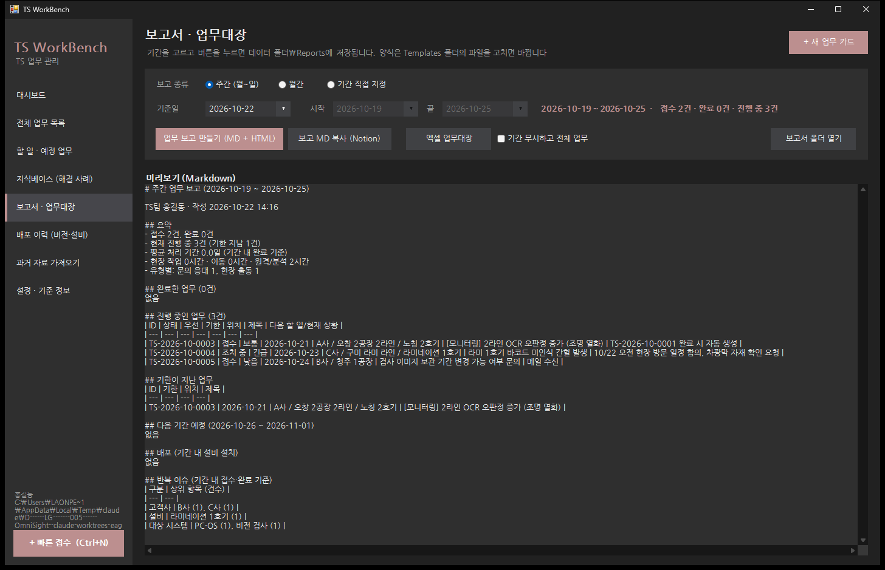
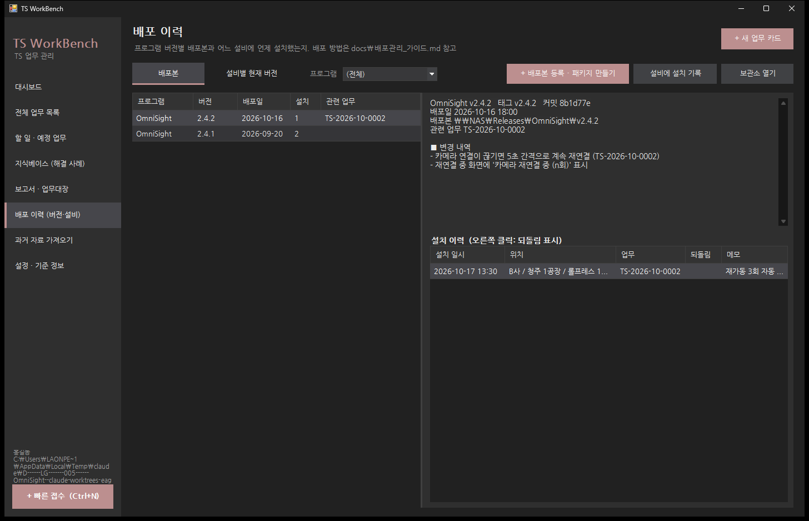
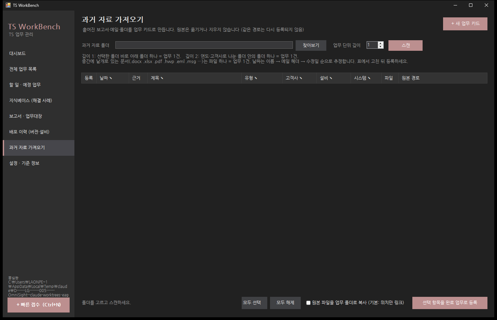
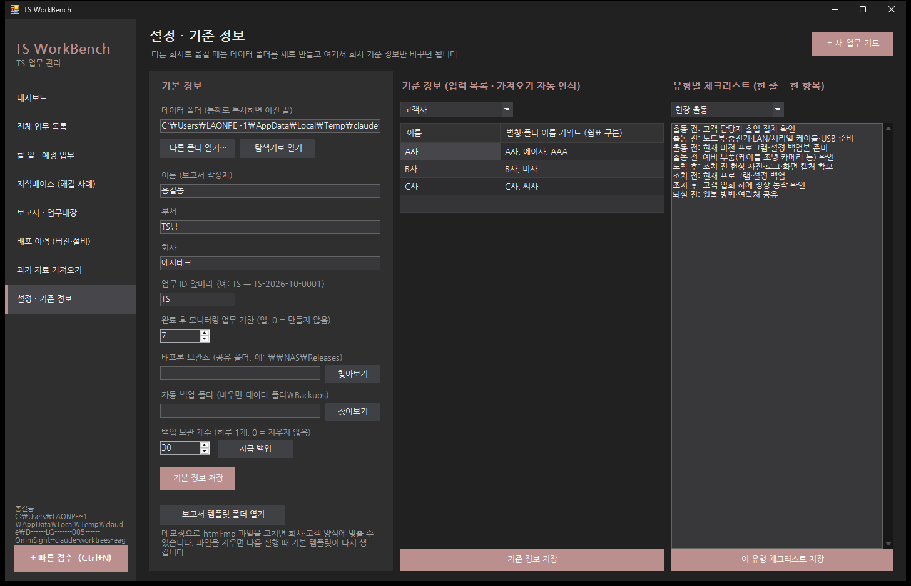

# TS WorkBench 사용설명서

> 버전 1.0 · .NET Framework 4.7.2 · Windows 10/11

이 문서는 **툴을 어떻게 쓰는지**를 설명합니다. **업무를 어떻게 관리하는지**(원칙·루틴·작성 요령)는 [TS업무관리_가이드.md](TS업무관리_가이드.md)를 보세요.

---

## 1. 설치와 첫 실행

1. 빌드 결과 폴더(`src\TSWorkBench\bin\Release\`)를 통째로 원하는 곳에 복사합니다. 설치 프로그램은 없습니다.
   - 필요한 파일: `TSWorkBench.exe`, `*.dll`, `TSWorkBench.exe.config`, `Templates\` 폴더
2. `TSWorkBench.exe`를 실행하면 **업무 데이터 폴더**를 고르는 창이 뜹니다.
   - 권장: `D:\박종부\TSWorkData` 처럼 프로그램과 **다른 폴더**, 가능하면 OneDrive 등 자동 백업되는 위치
   - 빈 폴더를 고르면 필요한 파일·폴더가 자동으로 만들어집니다.
3. 다음 실행부터는 마지막 데이터 폴더가 자동으로 열립니다. (경로는 `%AppData%\TSWorkBench\location.json`에만 기억)
4. 처음에는 **설정 · 기준 정보** 화면에서 이름·부서·회사와 고객사·설비 목록을 입력하세요.

### 예제로 먼저 체험하기

예제 데이터 폴더를 지정해서 실행하면 업무 6건이 들어 있는 상태로 볼 수 있습니다. 이 방법은 데이터 폴더 설정을 바꾸지 않습니다.

```
TSWorkBench.exe --data "D:\박종부\TSWorkBench\docs\examples\TSWorkData"
```

> 예제 폴더를 직접 고치고 싶지 않으면 다른 곳에 복사한 뒤 그 경로를 지정하세요.

---

## 2. 데이터 폴더 구조

```
TSWorkData\
  settings.json      이름·부서·회사·업무 ID 앞머리·후속 업무 일수
  masters.json       고객사·사이트/라인·설비·대상 시스템 목록, 유형별 체크리스트
  Items\
    2026\
      TS-2026-10-0001\
        item.json      업무 카드 1건 (사람이 읽을 수 있는 JSON)
        item.json.bak  직전 저장본 (파일이 깨지면 이걸로 복구)
        files\         복사 첨부한 사진·로그
        보고서_TS-2026-10-0001.html   현장 조치 보고서
  Templates\         보고서 양식 (고쳐서 쓰는 곳)
  Reports\           주간·월간 보고, 엑셀 업무대장
  Releases\          배포 기록 (OmniSight\2.4.2.json — 배포본 경로·변경 내역·설비 설치 이력)
  Backups\           자동 백업 zip (설정에서 다른 폴더로 바꿀 수 있음)
  Trash\             휴지통으로 보낸 업무 (완전히 지워지지 않음)
```

- **이전·백업 = 이 폴더 복사**가 전부입니다. 다른 회사로 옮길 때는 새 폴더로 시작하고, 이전 폴더는 보관용으로 두면 됩니다.
- 저장은 임시 파일에 먼저 쓰고 바꿔치기하므로 저장 중 PC가 꺼져도 원본이 깨지지 않습니다.
- 읽지 못한 업무 파일이 있으면 시작할 때 목록을 보여 줍니다. 같은 폴더의 `item.json.bak`을 `item.json`으로 바꾸면 복구됩니다.

---

## 3. 화면별 사용법

### 3.1 대시보드


- 숫자 카드: **진행 중 / 기한 지남 / 7일 안에 기한 / 모니터링·후속 / 이번 달 완료**. 누르면 해당 조건으로 업무 목록이 열립니다.
- 왼쪽 표: 해야 할 일 (기한 → 우선순위 순). 기한 지난 날짜는 **빨강**, 2일 이내는 **노랑**.
- 오른쪽 표: 최근 완료 30건.
- 더블클릭으로 업무 카드 열기, 오른쪽 클릭으로 보고서·Notion·폴더·휴지통.

### 3.2 빠른 접수 (Ctrl+N)



전화·메일을 받는 즉시 **제목·고객사·현상 한 줄**만 적고 `접수`를 누릅니다. 업무 ID가 붙고 접수 시각과 "업무 접수" 이력이 자동으로 남습니다. 바로 자세히 쓰려면 `접수 후 상세 입력`.

### 3.3 업무 카드


| 영역 | 내용 |
| --- | --- |
| 위쪽 요약 | ID, 제목, 유형, 상태, 우선순위, 태그, 고객사 › 사이트/라인 › 설비 › 대상 시스템, 접수 일시, 기한, 완료 일시, 요청자 |
| ① 현상 | 무엇이·어디서·얼마나, 발생 시점·빈도, 재현 조건, 영향 |
| ② 원인 | 원인, 근거(로그·측정값·5 Why) |
| ③ 조치 | 하드웨어 조치, 소프트웨어 조치, 변경 내역(파일·버전·설정 전→후) |
| ④ 검증·재발방지 | 검증 결과, 재발 방지, 고객 전달 사항, 재방문 필요/예정일 |
| 작업 이력 | 연락·통화·이동·현장·원격·분석 기록과 시간 합계 |
| 체크리스트 | 유형별 기본 항목 (설정에서 수정) |
| 첨부 | 사진·로그·메일·폴더 (복사 또는 링크) |

접수 일시·기한·완료 일시는 모두 날짜와 시각(`2026-10-22 14:30`)으로 입력합니다. 완료 일시는 상태가 **완료**일 때만 고칠 수 있습니다 (완료 처리하면 그 시각이 자동으로 들어가고, 실제 끝난 시각으로 고치면 됩니다).

아래 버튼:

- **저장 (Ctrl+S)** — 새 카드를 처음 저장하면 `저장했습니다. 업무 ID: …` 창이 뜹니다. 그다음부터는 창 없이 아래 버튼 줄에 `✔ 저장됨 14:32:10`이 몇 초 동안 표시됩니다. 저장하지 않고 닫으면 물어봅니다. `Esc`는 닫기.
- **ID 다시 부여** (업무 ID 옆) — 업무 ID는 처음 저장할 때 접수 일시의 연·월로 정해집니다. 접수 일시를 다른 달로 고치고 저장하면 ID를 바꿀지 자동으로 묻고, 이 버튼으로 언제든 다시 맞출 수 있습니다 (아래 "접수 일시를 고쳤을 때").
- **▶ 다음 단계** — 접수 → 분석 → 조치 중 → 검증(모니터링) → 완료 순서로 한 단계 진행.
- **상태 변경 ▾** — 보류·취소·재오픈 등 허용된 상태로 바로 변경. 바꿀 때마다 작업 이력에 자동 기록.
- **현장 조치 보고서** — 업무 폴더에 HTML 보고서를 만들고 브라우저로 엽니다. 브라우저에서 `Ctrl+P` → PDF로 저장하면 고객 제출용 PDF가 됩니다. 첨부한 사진(jpg·png)이 자동으로 들어가고 첨부 메모가 사진 설명이 됩니다.
- **Notion MD 복사** — 카드 전체를 Markdown으로 클립보드에 복사. Notion 페이지에 붙여넣으면 표·제목이 그대로 살아납니다.
- **폴더 열기** — 업무 폴더를 탐색기로 엽니다.
- **유사 사례 (n)** — 같은 설비·대상 시스템·고객사, 겹치는 태그·단어가 많은 과거 업무를 찾아 줍니다. 괄호 숫자는 찾은 건수이고, 새 카드에서 비슷한 사례가 있으면 버튼이 강조색이 됩니다. 사례를 고르고 `원인 근거에 이 사례 추가`를 누르면 ②원인 › 근거 칸에 `참고 사례: ID 제목 — 원인: …`이 들어갑니다.
- **배포 기록** — 이 업무로 프로그램을 설치했을 때 누릅니다. 배포본을 고르면 카드의 고객사·설비·ID로 설치 기록이 남고, ③조치 › 변경 내역과 작업 이력에 자동으로 적힙니다 (3.7 배포 이력, [배포관리_가이드.md](배포관리_가이드.md)).

**접수 일시를 고쳤을 때 (업무 ID 다시 부여)**

예) 5월 작업인데 접수 일시를 6월로 잘못 넣고 저장해서 `TS-2026-06-0003`을 받은 경우
1. 접수 일시를 `2026-05-28 14:00`으로 고치고 저장
2. "업무 ID를 TS-2026-06-0003 → TS-2026-05-0012로 바꿀까요?" → **예**
3. 함께 바뀌는 것: 업무 폴더(`Items\2026\…`, 첨부 포함), 이 업무에서 생긴 후속 업무의 원본 ID, 배포 기록의 업무 ID. 작업 이력에 `업무 ID 변경: 이전 → 새`가 남습니다.
4. 그대로인 것: 이미 만든 보고서 파일(새로 만들면 새 ID로 나옴), 다른 카드 글 속에 직접 적어 둔 ID 글자
- **아니요**를 고르면 ID는 그대로 두고 저장합니다. 같은 달로는 그 창에서 다시 묻지 않으며, 나중에 `ID 다시 부여` 버튼으로 바꿀 수 있습니다.
- 버리게 된 예전 번호(`TS-2026-06-0003`)는 다른 업무에 다시 쓰지 않습니다.

**완료 처리할 때**

1. 현상·원인·조치·검증 결과가 비어 있으면 경고합니다. (문의 응대·정기 점검·후속 확인은 현상만 확인)
2. 현장 출동·HW 조치·프로그램 수정을 완료하면 **"[모니터링] 제목" 후속 업무**(기본 7일 뒤 기한)를 만들지 묻습니다.
3. "재방문 필요"를 체크했다면 **"[재방문] 제목" 현장 출동 업무**도 함께 만듭니다.

**작업 이력 입력**



- `시작 = 지금` → 구분 선택 → 내용 입력 → `추가`. 끝날 때 해당 행을 선택하고 `종료 = 지금` → `선택 행 수정`.
- 종료가 있는 항목만 시간이 계산됩니다. 현장·이동·원격/분석 시간은 주간·월간 보고에 합산됩니다.

**첨부**

- `파일 복사 첨부` 또는 **목록으로 끌어다 놓기** → 업무 폴더 `files\`로 복사 (사진·작은 로그)
- `원본 파일 링크`, `폴더 링크` → 위치만 기록 (큰 파일, 공유 폴더)
- `캡처 이미지 붙여넣기` → `Win+Shift+S`로 캡처한 화면을 PNG로 저장
- 메모 칸은 바로 고칠 수 있고, 현장 보고서의 사진 설명으로 쓰입니다.

### 3.4 전체 업무 목록 / 할 일 · 예정 업무



- 검색: 띄어쓰기로 여러 단어 → 모두 포함된 업무 (제목·현상·원인·조치·이력 전체 검색)
- 상태: 전체 / 진행 중 / 기한 지남 / 7일 안에 기한 / 모니터링·후속 / 각 상태
- 기간: 그 기간에 **접수 또는 완료**된 업무
- `Enter` 또는 더블클릭: 열기, `Delete`: 휴지통, `F5`: 새로 고침
- `이 목록 엑셀로`: 현재 필터 결과를 xlsx로 저장
- 오른쪽 클릭 › **복제해서 새 업무 (반복 업무)**: 고객사·설비·시스템·제목·현상·체크리스트(체크 해제)를 그대로 가져온 새 카드를 엽니다. 분기 정기 점검처럼 반복되는 업무에 쓰세요. 원인·조치·이력·첨부는 비어 있습니다.
- **할 일 · 예정 업무**는 진행 중인 업무만 기한·우선순위 순으로 보여 주는 같은 화면입니다.

### 3.5 지식베이스 (해결 사례)



완료된 업무를 검색해서 오른쪽에 **현상 → 원인 → 조치 → 재발방지**를 바로 보여 줍니다. 같은 증상 연락이 오면 먼저 여기서 찾아보세요. `진행 중 업무도 포함`을 켜면 진행 중인 건도 찾습니다.

### 3.6 보고서 · 업무대장



- **주간**(기준일이 속한 월~일), **월간**, **기간 직접 지정** 중 선택하면 아래에 미리보기가 나옵니다.
- `업무 보고 만들기 (MD + HTML)` → `Reports\주간업무보고_시작_끝.md/.html` 저장 후 HTML을 엽니다.
  - 내용: 요약(접수·완료·진행·지연·평균 처리 기간·현장/이동/원격 시간), 완료 업무, 진행 중 업무, 기한 지난 업무, 다음 기간 예정, 배포(기간 내 설비 설치), 반복 이슈 Top 5
- `보고 MD 복사 (Notion)` → 미리보기 내용을 클립보드로
- `엑셀 업무대장` → 기간 안에 접수·완료된 업무 (체크하면 전체) + 통계 시트

### 3.7 배포 이력 (버전·설비)



프로그램을 수정·배포할 때 **어느 버전을 언제 어느 설비에 설치했는지** 기록합니다. 코드·매뉴얼·배포 파일을 어떻게 나눠 보관하는지는 [배포관리_가이드.md](배포관리_가이드.md)에 정리했습니다.

- **+ 배포본 등록 · 패키지 만들기**
  - *빌드 폴더로 패키지 만들기*: 프로그램·버전·빌드 폴더(bin\Release)·매뉴얼 폴더·변경 내역을 넣으면 설정의 **배포본 보관소**에 `프로그램\v버전\` 폴더를 만듭니다 (zip, manual\, RELEASE_NOTES.md, SHA256SUMS.txt). 같은 버전 폴더가 있으면 덮어쓰지 않고 거부합니다. 끝나면 `git tag` 명령이 클립보드에 복사됩니다.
  - *이미 있는 배포본 등록만*: 다른 방법으로 만든 배포 폴더 경로만 기록합니다.
- **설비에 설치 기록**: 배포본·고객사·사이트·설비·설치 일시·관련 업무를 기록합니다. 업무 카드의 `배포 기록` 버튼을 쓰면 위치와 ID가 자동으로 채워집니다.
- **배포본** 보기: 왼쪽 버전 목록, 오른쪽에 변경 내역과 설치 이력. 설치 이력에서 오른쪽 클릭 › `되돌림 표시 / 해제` (롤백했을 때).
- **설비별 현재 버전** 보기: 설비마다 프로그램별 마지막 설치 버전 (되돌림 표시한 설치는 빠짐).
- `보관소 열기`: 선택한 배포본 폴더(없으면 보관소)를 엽니다.

### 3.8 과거 자료 가져오기



정리되지 않은 예전 보고서·메일·폴더를 **완료 업무**로 한꺼번에 등록합니다. 원본은 옮기거나 지우지 않습니다.

1. `찾아보기`로 과거 자료 최상위 폴더 선택
2. **업무 단위 깊이** 선택
   - 1: 선택한 폴더 바로 아래 폴더 하나 = 업무 1건
   - 2: `연도\업무폴더`, `고객사\업무폴더`처럼 한 번 더 들어간 폴더 하나 = 업무 1건
   - 중간에 낱개로 있는 문서(.docx .xlsx .pdf .hwp .eml .msg .txt .zip …)는 파일 하나 = 업무 1건
3. `스캔` → 표에 후보가 나옵니다.
   - 날짜: 이름의 `20241021`, `2024-10-21`, `2024.10.21`, `241021` → 메일(.eml) 헤더 → 파일 수정일 순으로 추정 (근거 칸에 표시)
   - 고객사·설비·시스템: 설정의 기준 정보 이름·별칭이 경로에 들어 있으면 자동으로 채움
   - 유형: 이름의 "교체·점검·수정·분석·문의·출동" 같은 단어로 추정
4. ✎ 표시가 있는 칸(날짜·제목·유형·고객사·설비·시스템)을 고치고, 등록하지 않을 줄은 체크 해제
5. `선택 항목을 완료 업무로 등록` → 태그 `과거이관`, 원본 위치가 첨부 링크로 들어갑니다.
   - `원본 파일을 업무 폴더로 복사`를 켜면 파일까지 복사합니다 (용량 주의).
   - 이미 등록한 경로는 회색으로 표시되고 다시 등록되지 않습니다.
6. 중요한 건은 업무 카드를 열어 현상·원인·조치를 채워 두면 지식베이스에서 찾을 수 있습니다.

> 팁: 스캔 전에 **설정 → 기준 정보**에 고객사·설비의 별칭(폴더 이름에 쓰던 표기)을 넣어 두면 자동 인식률이 올라갑니다. 예) 노칭 2호기 → `NOTCHING, 노칭, NT2`

### 3.9 설정 · 기준 정보



- **기본 정보**: 이름(보고서 작성자), 부서, 회사, 업무 ID 앞머리(`TS` → `TS-2026-10-0001` = 앞머리-연도-월-그 달의 순번, 달마다 0001부터), 완료 후 모니터링 업무 기한(일, 0이면 만들지 않음)
- **배포본 보관소**: 배포 패키지를 만들 공유 폴더 (예: `\\NAS\Releases`)
- **자동 백업 폴더 / 보관 개수**: 프로그램을 켤 때 하루 한 번 `TSWorkData_날짜.zip`(설정·기준 정보·모든 업무 카드·템플릿, 첨부 파일 제외)을 만듭니다. 비우면 데이터 폴더\Backups. **데이터와 다른 디스크나 공유 폴더**로 지정하는 것을 권장합니다. 보관 개수를 넘으면 오래된 것부터 지웁니다. `지금 백업`은 시각을 붙여 따로 남깁니다.
- **데이터 폴더**: `다른 폴더 열기…`로 다른 작업 공간을 엽니다 (회사·프로젝트별로 나눠 쓸 때).
- **기준 정보**: 고객사 / 사이트·라인 / 설비 / 대상 시스템 / 프로그램(배포용) 목록. 이름은 입력 칸의 목록으로, 별칭은 가져오기 자동 인식에 쓰입니다. 표 맨 아래 빈 줄에 입력하면 추가, 이름 칸을 비우면 삭제됩니다. 고친 뒤 `기준 정보 저장`.
- **유형별 체크리스트**: 한 줄 = 한 항목. 새로 만드는 업무부터 적용됩니다.
- **보고서 템플릿 폴더 열기**: 4.장 참고

---

## 4. 보고서 양식 고치기 (템플릿)

데이터 폴더 `Templates\`의 파일을 메모장이나 VS Code로 고치면 됩니다. 중괄호 두 겹으로 감싼 이름(예: `{{Title}}`)이 값으로 바뀝니다.

| 파일 | 용도 |
| --- | --- |
| `field-report.html` | 현장 조치 보고서 |
| `item-notion.md` | 업무 카드 Notion Markdown |
| `period-report.md` / `period-report.html` | 주간·월간 보고 |

**업무 카드에서 쓸 수 있는 이름**

`Id` `Title` `Type` `Status` `Priority` `Customer` `Site` `Equipment` `TargetSystem` `Location` `Tags` `Requester` `ReceivedAt` `DueDate` `CompletedAt` `Symptom` `SymptomWhen` `Reproduction` `Impact` `Cause` `CauseEvidence` `ActionHardware` `ActionSoftware` `ChangedFiles` `Verification` `Prevention` `CustomerNote` `Revisit` `TotalHours` `Timeline` `Checklist` `Attachments` `Photos`(HTML만) `Author` `Department` `Company` `GeneratedAt`

**기간 보고에서 쓸 수 있는 이름**

`ReportTitle` `Period` `NextPeriod` `Summary` `DoneCount` `DoneList` `ActiveCount` `ActiveList` `OverdueList` `PlannedList` `TopIssues` `Author` `Department` `Company` `GeneratedAt`

- 모르는 이름은 빈칸이 됩니다.
- 파일을 지우면 다음 실행 때 기본 템플릿이 다시 복사됩니다.
- 회사 로고를 넣으려면 `field-report.html`의 `<header>` 안에 ``처럼 추가하세요.

---

## 5. 단축키

| 키 | 동작 |
| --- | --- |
| Ctrl+N | 빠른 접수 |
| Ctrl+Shift+N | 새 업무 카드 (전체 입력) |
| F5 | 현재 화면 새로 고침 |
| Ctrl+S | 업무 카드 저장 |
| Esc | 업무 카드 닫기 |
| Enter / 더블클릭 | 목록에서 열기 |
| Delete | 목록에서 휴지통으로 |
| F4, Alt+↓ | 날짜 칸 달력 열기 |

날짜 칸은 `2026-10-22`, `2026-10-22 14:30`처럼 직접 입력해도 됩니다. 비우면 "없음"입니다.

---

## 6. 자주 묻는 것

**Q. 여러 PC에서 같이 쓸 수 있나요?**
데이터 폴더를 공유 폴더·OneDrive에 두면 여러 PC에서 열 수 있습니다. 다만 같은 업무 카드를 두 PC에서 동시에 고치면 나중에 저장한 쪽이 남습니다. 혼자 쓰는 것을 기준으로 만들었습니다.

**Q. 실수로 지웠어요.**
휴지통(`Trash\업무ID_시각`) 폴더를 `Items\연도\` 아래로 다시 옮기고 업무ID 이름으로 바꾼 뒤 F5.

**Q. 엑셀 저장이 실패해요.**
같은 이름의 파일이 엑셀에서 열려 있으면 저장할 수 없습니다. 엑셀을 닫고 다시 누르세요.

**Q. 업무 ID를 바꾸고 싶어요.**
ID는 폴더 이름과 보고서에 쓰이므로 마음대로 바꾸지는 않습니다. 회사가 바뀌면 설정에서 앞머리만 바꾸세요(새 업무부터 적용).

**Q. 접수 일시를 잘못 넣고 저장해서 ID의 월이 틀렸어요.**
업무 카드에서 접수 일시를 바로잡고 저장하면 ID를 바꿀지 묻습니다. 예를 누르면 맞는 달의 새 번호로 바뀝니다 (3.3 "접수 일시를 고쳤을 때").

**Q. 데이터를 통째로 잃었어요 (디스크 고장 등).**
자동 백업 폴더의 가장 최근 `TSWorkData_날짜.zip`을 새 폴더에 풀고, 설정 › 다른 폴더 열기로 그 폴더를 지정하세요. 첨부 파일(files\)은 백업에 들어가지 않으므로 데이터 폴더 자체도 OneDrive·공유 폴더에 두는 것이 안전합니다.

**Q. 오류가 났는데 무슨 오류였는지 보고 싶어요.**
`%AppData%\TSWorkBench\error.log`에 시각과 함께 남습니다 (탐색기 주소창에 그대로 입력). 1MB를 넘으면 `error.log.old`로 한 번 바꿔 둡니다.

**Q. 글꼴은 무엇을 쓰나요?**
실행 파일에 넣은 나눔고딕을 씁니다 (PC에 설치하지 않아도 됨). 읽지 못하면 맑은 고딕으로 대신합니다.
